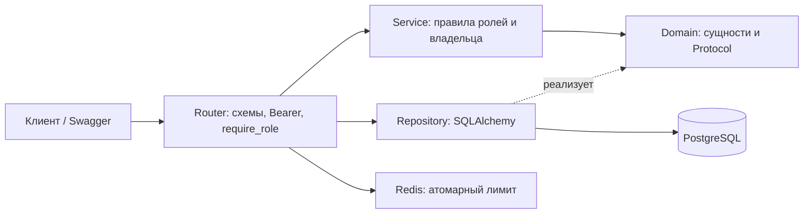

# Практическая работа №3. Аутентификация и авторизация

FastAPI-приложение «Сириус.Еда»: PostgreSQL, SQLAlchemy, Alembic, JWT, bcrypt, Redis. Выполнены базовая часть, самостоятельная работа по users/menu/delivery, меры уровня 9 и refresh token rotation уровня 10.

Предыдущие `lab-01/` и `lab-02/` исследовали индексы PostgreSQL и содержат другой учебный сервис заказов. Описанного в задании проекта «Сириус.Еда» в репозитории не было: здесь создан отдельный проект с разделением слоёв. Старые работы и их базы не изменяются. Поэтому миграция здесь начальная, а не изменение отсутствующей legacy-таблицы users. Автогенерация Alembic выполнена на PostgreSQL, затем добавлено заполнение четырёх ролей. Пользователи и пароли по умолчанию не создаются.

## Запуск

Python 3.12, Docker с Compose v2; команды **из `lab-03/`**:

```bash
cd lab-03 # если вы в корне репозитория
python3 -m venv .venv
source .venv/bin/activate
pip install -r requirements-dev.txt
python scripts/init_env.py
docker compose up -d --wait db redis
alembic upgrade head
python -m app.bootstrap admin@example.org
```

Пароль администратора вводится в терминале дважды, без отображения. `init_env.py` создаёт приватный игнорируемый `.env` со случайными секретами. `.env.example` показывает настройки; значения-заглушки JWT не принимаются. Для локальной работы со Swagger измените в `.env` `DEBUG=false` на `DEBUG=true`, затем:

```bash
uvicorn app.main:app --host 127.0.0.1 --port 8000 --no-proxy-headers
```

Откройте http://127.0.0.1:8000/docs. PostgreSQL слушает только `127.0.0.1:15433`, Redis — `127.0.0.1:16380`, API — `127.0.0.1:8000`. Данные PostgreSQL сохраняются в отдельном volume `rpm-lab03_pgdata`; обычная остановка: `docker compose stop`. Отдельная база не использует trust-аутентификацию. Не меняйте пароль в `.env` у уже инициализированного volume без изменения пароля в PostgreSQL.

## Демонстрация в Swagger

1. `POST /users/register`: зарегистрируйте двух студентов с разными email и паролем длиной 12–72 **байта UTF-8**. Роль всегда student, дополнительные поля role/user_id отклоняются с 422.
2. Нажмите **Authorize**. В `username` укажите email, в `password` — пароль. Swagger использует форму `POST /auth/token`; для JSON-клиентов есть `POST /auth/login` с email/password. Оба пути имеют один общий лимит попыток.
3. Войдите администратором; `GET /users` показывает ID. Через `PATCH /users/{id}` назначьте зарегистрированным рабочим аккаунтам роль cook/courier. Создайте блюдо через `POST /menu`.
4. Войдите первым студентом и вызовите `POST /orders/create` с `{"item_id":1,"quantity":2}`. Ответ: `{"status":"success","order_id":1}`. customer_id берётся из подтверждённой сервером личности.
5. Войдите вторым студентом: чтение и отмена первого заказа вернут 403. Первый студент может отменить свой заказ. Повторная отмена — 409. Несуществующий объект — 404.
6. Студент получает 403 на `GET /kitchen/orders`; cook получает список ожидающих заказов без email/customer_id. Cook не может создавать заказы.
7. Администратор назначает доставку `POST /delivery` с order_id и courier_id. Только назначенный курьер, владелец заказа и admin могут её читать; завершить может только назначенный курьер. Другой курьер и другой студент получают 403 и не видят её в списке.
8. `POST /auth/refresh` выдаёт новую пару. Повторите запрос со **старым** refresh: 401; новая пара той же сессии тоже перестанет работать. Другая независимо открытая сессия сохраняется. `POST /auth/logout` отзывает текущую сессию.
9. Шестая попытка входа с одного адреса за 60 секунд — 429 с Retry-After. Для следующей демонстрации подождите окно, а не отключайте защиту.

## Права

| Действие | student | cook | courier | admin |
|---|---|---|---|---|
| Профиль | свой | свой | свой | любой, список, роль/блокировка |
| Читать меню | да | да | да | да |
| Изменять меню | 403 | да | 403 | да |
| Создать заказ | от своего имени | 403 | 403 | 403 |
| Читать/отменять заказ | свой | 403 для чужих | 403 для чужих | любой |
| Кухня | 403 | ожидающие, без данных клиента | 403 | 403 |
| Читать доставку | своего заказа | 403 | назначенную себе | любую |
| Назначить доставку | 403 | 403 | 403 | да |
| Завершить доставку | 403 | 403 | назначенную себе | 403 |

Admin не является неявным обходом всех правил: роли разрешаются явно. Все списки ограничены 100 строками и фильтруются по владельцу/назначению до выдачи. Публичны только регистрация, вход, refresh по refresh-токену и health; для этих операций access-токена ещё может не быть. Остальные изменяющие операции требуют get_current_user напрямую или через require_role.

## Схема безопасности и архитектура



`domain/` содержит dataclass-сущности, исключения и интерфейсы. `modules/*/service.py` зависит от интерфейсов, не импортирует FastAPI, Redis или SQLAlchemy. API компонует сервис и адаптеры. `repository.py` выполняет запросы и транзакции; только API переводит доменные исключения в 401/403/404/409. Проверки владельца не зависят от HTTP и отдельно протестированы без роутера. RBAC в dependency отсекает запрос раньше; проверки ролей в сервисах сохраняют правила при вызове вне HTTP.

Пароли: bcrypt с независимой солью и cost=12. Используется поддерживаемый `bcrypt` напрямую вместо старого passlib, чтобы избежать несовместимости его backend с современным bcrypt. Пароли не усекаются до 72 байт. Для неизвестного email выполняется проверка dummy-хеша; ошибки входа одинаковы, заблокированные пользователи войти не могут.

Access JWT живёт до 15 минут, refresh-сессия — 7 дней от входа (ротация не продлевает абсолютный срок). Проверяются подпись HS256, exp, iat, iss, aud, sub, jti, sid и type. Access и refresh не взаимозаменяемы. Роль и blocked загружаются из БД на каждом запросе, не берутся из устаревших claims. JWT не содержит email или паролей, но его payload читается без ключа — это подпись, не шифрование.

В БД хранятся только SHA-256-хеши refresh JWT, сроки и признак использования. SHA-256 подходит здесь для высокоэнтропийного токена; для пароля нужен медленный bcrypt. Ротация блокирует строку семейства через `SELECT FOR UPDATE`, атомарно помечает старый токен использованным и сохраняет новый. Два одновременных refresh одного токена дают один успех и одно обнаружение replay; после него всё семейство отозвано. Отзыв фиксируется до возврата 401. Access тоже проверяет семейство в БД, поэтому logout/replay/блокировка немедленно прекращают доступ. Это осознанная цена отказа от полностью stateless JWT. Блокировка пользователя отзывает все его сессии; разблокировка их не восстанавливает.

Redis хранит общие для реплик счётчики с TTL; Lua делает INCR и EXPIRE атомарно. Ограничены вход (5/60 секунд), регистрация (5/60), refresh (20/60), создание заказов (10/60). При недоступности Redis защищённые лимитом операции возвращают 503. IP берётся из реального соединения, X-Forwarded-For не доверяется; запуск указан с `--no-proxy-headers`. Если размещать API за reverse proxy, нужно отдельно настроить доверенные proxy и сохранить корректный адрес клиента. IP-лимит не заменяет полноценную защиту от распределённого брутфорса и может затронуть пользователей за общим NAT.

Secure by Default: DEBUG=false, в этом режиме выключены `/docs`, `/redoc` **и** `/openapi.json`; CORS допускает только явный список origins; секреты обязательны и находятся в `.env`; в коде нет стандартного администратора. Для внешнего развёртывания нужен HTTPS. Клиент хранит Bearer-токены как секреты; приложение не использует cookies и не добавляет токены в URL/логи. Здесь нет внешнего OAuth-провайдера: выбран бонус с ротацией.

## Проверки и CI

Проверки используют **настоящие PostgreSQL и Redis**, а не SQLite или in-memory лимитер. При первом запуске создайте отдельную тестовую базу:

```bash
docker compose exec db createdb -U sirius sirius_test
python scripts/check.py
```

`check.py` выводит имя тестовой базы из DATABASE_URL (добавляет `_test`), применяет Alembic дважды, проверяет отсутствие расхождений моделей и миграции, затем запускает pytest. При необходимости задайте TEST_DATABASE_URL явно. Фикстуры отказываются работать без суффикса `_test`, очищают таблицы **только этой тестовой БД** перед каждым тестом. Redis для тестов — отдельная DB 15, очищаются только ключи `sirius:rate:*`. Не направляйте эти настройки на используемые другими приложениями базы. Исходные настройки разработки не перезаписываются.

Покрыты: 401 без токена; 403 для чужой роли/объекта; неизменность чужого заказа; запрещённая подмена владельца и эскалация роли; безопасный bcrypt и длина UTF-8; изоляция доставок; лимит 429 и TTL в Redis; отказ Redis; ротация/replay/конкурентная ротация и независимые сессии; logout и блокировка; подделка/истечение/тип JWT; Swagger OAuth2; CORS и отключение документации; правило зависимостей и прямой вызов сервиса.

[GitHub Actions workflow](../.github/workflows/lab-03.yml) запускает эти же проверки на push и pull request с PostgreSQL/Redis services. [Локальный результат JUnit](docs/test-results.xml). [Протокол проверки](docs/validation.md). Данные тестовых пользователей существуют только в тестовой базе и не добавляются миграциями.

## Ответы для защиты

1. Аутентификация устанавливает личность (проверка пароля/JWT), авторизация — разрешённое действие (роль/владелец). Принять поддельный JWT — ошибка первой; разрешить отменить чужой заказ — второй.
2. Поле user_id клиента можно изменить. Владельца сервер определяет из проверенного sub и существующей активной сессии.
3. IDOR — доступ к чужому объекту по подставленному ID. Проверка customer_id/courier_id находится в Service как бизнес-правило, работает и без HTTP.
4. Payload JWT только Base64URL-кодирован. Подпись запрещает незаметное изменение, но не скрывает содержимое.
5. API проверяет роль операции через dependency; Service знает объект и проверяет право на него. Сервис дополнительно сохраняет ролевые правила для вызовов из других адаптеров.
6. Redis объединяет счётчики реплик; память каждого процесса позволила бы обходить лимит переключением между репликами. Атомарность и TTL исключают потерю срока счётчика при гонке.
7. Secure by Default — безопасный запуск без дополнительных действий: обязательный случайный ключ, выключенные production docs, явный CORS allowlist, отсутствие известных паролей.
8. Импорт HTTPException в Service нарушает направление зависимостей: бизнес-правила становятся зависимыми от транспорта. Здесь Service бросает доменное исключение, API переводит его в HTTP-статус.
