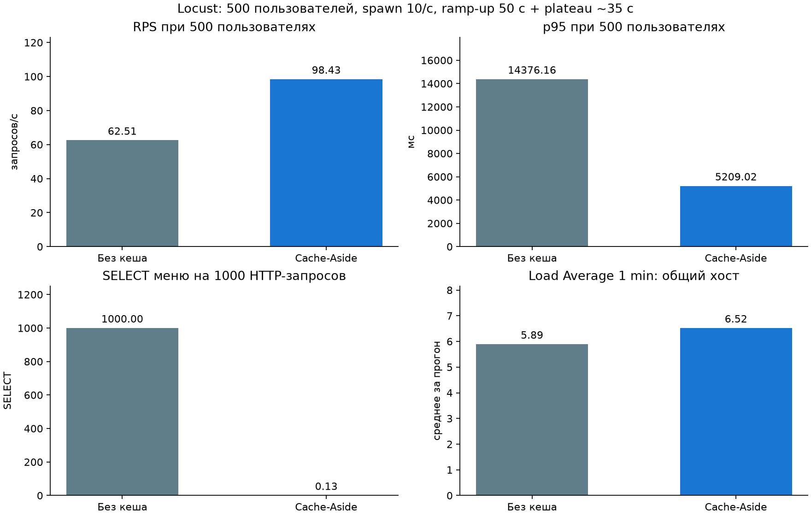
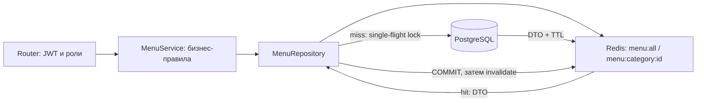

# Лабораторная №4. Cache-Aside на Redis

Продолжение «Сириус.Еда» из `lab-03/` в **отдельном самодостаточном каталоге**. Сохранены JWT, роли, IDOR-защита, bcrypt, refresh rotation и rate limiting. Старые работы не изменяются. Реализованы Cache-Aside в Repository, TTL и событийная инвалидация, Redis-блокировка от stampede, кеш категорий и прогрев при старте.

[Замеры и графики «до/после»](docs/measurements.md) · [Проверки](docs/validation.md) · [Locust](locustfile.py).

<!-- measurements:start -->
## Измеренный результат



| Метрика | До | После |
|---|---:|---:|
| RPS при 500 пользователях | 62.51 | 98.43 |
| p95 при 500 пользователях, мс | 14376.16 | 5209.02 |
| SELECT меню за прогон | 5639 | 1 |
| Load Average 1 min общего хоста, среднее | 5.89 | 6.52 |

В обоих режимах достигнуты 500 пользователей, HTTP-ошибок нет. RPS/p95 относятся к окну 50–85 с; SELECT и Load Average — ко всему прогону. Авторизация сохранена. [Методика, ограничения и исходные данные](docs/measurements.md).
<!-- measurements:end -->

## Запуск

Python 3.12, Docker Engine с Compose v2. Из корня репозитория:

```bash
cd lab-04
python3 -m venv .venv
source .venv/bin/activate
pip install -r requirements-dev.txt
python scripts/init_env.py
docker compose up -d --wait db redis
alembic upgrade head
python -m app.bootstrap admin@example.org
uvicorn app.main:app --host 127.0.0.1 --port 8000 --no-proxy-headers
```

`init_env.py` создаёт приватный `.env` со случайными паролем БД и JWT-ключом. При повторном вызове существующий файл не меняется. Для Swagger включите `DEBUG=true` в `.env` и перезапустите API; откройте http://127.0.0.1:8000/docs. По умолчанию DEBUG=false: документация и OpenAPI закрыты. Администратор создаётся явно через безопасный ввод пароля в терминале. Через регистрацию создаются только student; рабочие роли cook/courier назначает admin через PATCH /users/{id}. Создавать и менять меню могут только cook/admin. Детали безопасности и таблица ролей — [в третьей работе](../lab-03/README.md).

Отдельные инфраструктура и volume: `rpm-lab04`, PostgreSQL `127.0.0.1:15434`, Redis `127.0.0.1:16381`. API читает свои DATABASE_URL/REDIS_URL из `.env`. Базы и Redis предыдущих работ не используются. Остановка: `docker compose stop`. Смена POSTGRES_PASSWORD в файле не меняет пароль уже созданного volume.

Миграции: начальная версия из lab-03 плюс новая с тремя категориями («Общее», «Супы», «Напитки») и FK menu.category_id. Существующие блюда получают категорию «Общее», данные сохраняются; rollback новой миграции и повторное применение проверены. Новая миграция сгенерирована Alembic и доработана для заполнения справочника и именованного FK.

## API и ручная проверка

В Swagger **Authorize** использует email в поле username (`POST /auth/token`). JSON-вход: `POST /auth/login`. Секреты и токены не публикуются. Доступ к меню остаётся защищённым, даже если ответ уже в кеше.

| Операция | Путь | Доступ |
|---|---|---|
| Меню (первые 100, категория → имя → id) | GET /menu/items | любой активный пользователь |
| Блюда категории (первые 100) | GET /menu/categories/{id} | любой активный пользователь |
| Создать блюдо | POST /menu/items | cook/admin |
| Изменить блюдо | PATCH /menu/items/{id} | cook/admin |

Старые `/menu` и `/menu/{id}` сохранены как совместимые aliases. Поля меню дополнены category_id и category_name; цена остаётся точной Decimal, JSON содержит строку (`"125.50"`), а не float. Изменение принимает name, price и category_id (по умолчанию 1). Категорий нет в общедоступном CRUD: три справочные категории создаёт миграция.

1. Войдите cook/admin, создайте блюдо: `{"name":"Суп","price":"125.50","category_id":2}`.
2. Дважды вызовите GET /menu/items. После первого miss второй запрос вернёт hit. Благодаря прогреву первый запрос после старта обычно сразу hit.
3. Выполните `docker compose exec redis redis-cli TTL menu:all` — значение 1..300. Посмотреть DTO: `docker compose exec redis redis-cli GET menu:all`.
4. Вызовите GET /menu/categories/2. Ключ `menu:category:2` имеет TTL 1..600. Пустой список тоже кешируется; неизвестная категория даёт 404 и не записывается.
5. Измените цену или переместите блюдо в другую категорию. После успешного COMMIT удаляются menu:all и ключи старой/новой категории; следующий GET сразу прочтёт новые данные. Ключи других категорий остаются.
6. Без токена GET даёт 401; student не может записывать меню (403). Кеш не содержит пользователей, сессии, пароли, балансы или права доступа.

## Устройство кеша



`service.py` не импортирует Redis и не знает о TTL, hit/miss или блокировках. Адаптер `modules/menu/cache.py` используется только репозиторием и композицией приложения. Repository возвращает одинаковые доменные dataclass DTO из БД и кеша; SQLAlchemy-объекты и pickle в Redis не помещаются. JSON-декодер проверяет структуру; повреждённый payload заменяется чтением из БД. Для пустого массива проверяется `is not None`, чтобы `[]` не считался miss.

Cache-Aside: GET ключа → hit возвращает DTO → miss получает Redis lease через SET NX EX → повторно проверяет ключ → читает PostgreSQL → публикует JSON с TTL → освобождает только собственную блокировку. Параллельные читатели ожидают готовый результат и получают его из Redis. Блокировка действует между процессами/репликами; она не является локальным asyncio.Lock.

Защита от гонки «старый loader после записи»: перед загрузкой фиксируется `menu:generation`. Инвалидация одним Lua-скриптом увеличивает поколение и удаляет затронутые ключи. Публикация другим Lua-скриптом проверяет и поколение, и владельца lease. Устаревший читатель может завершить начатый до записи запрос старым snapshot, но **не сможет заново наполнить кеш старым результатом**. Работник с истёкшим lease не удаляет чужую блокировку и не публикует значение. Это проверяется тестами с управляемыми параллельными чтением/записью.

Настройки `.env` (значения по умолчанию):

```dotenv
CACHE_ENABLED=true
CACHE_WARMUP=true
MENU_TTL=300
CATEGORY_TTL=600
CACHE_LOCK_SECONDS=10
CACHE_WAIT_SECONDS=3
```

Read-соединения аутентификации освобождаются до возврата dependency; чтение меню использует отдельный ограниченный контекст Session. Соединение не удерживается во время ожидания cache-lock и сериализации ответа. Это одинаково для baseline и Cache-Aside и защищено регрессионным тестом.

При старте lifespan прогревает menu:all через тот же Repository в рабочем потоке, без блокировки event loop. Все ключи читаются из Redis с короткими таймаутами 100 мс без автоматических повторов. Если Redis кеша недоступен, GET и запись меню продолжают работать через PostgreSQL. Запись не откатывается из-за недоступной инвалидации. **Rate limiting из lab-03 по-прежнему fail-closed:** вход/регистрация/refresh при полном отказе Redis возвращают 503; уже аутентифицированный пользователь может читать меню из БД и менять его согласно роли.

Ограничения согласованности: Redis и PostgreSQL не образуют общую транзакцию. Между COMMIT и invalidate есть короткое окно старого hit. При недоступности Redis во время записи старый ключ после восстановления может дожить до TTL (до 5/10 минут); TTL — страховка, а не строгая согласованность. Для требования немедленной согласованности после сбоев нужен transactional outbox/CDC или другой протокол. Не выдаём best-effort delete за гарантию атомарности двух хранилищ.

Ожидание блокировки ограничено 3 с, lease — 10 с. Если владелец завис, после таймаута запрос идёт в БД без публикации в кеш; при отказе Redis распределённая single-flight защита недоступна. Это сохраняет доступность, но может поднять нагрузку на PostgreSQL. Для медленных loader нужна настройка lease, backpressure/ограничение конкурентности или продление lease. Текущий тест подтверждает один loader при нормальной конкурентной загрузке; не обещает этого при любых сбоях.

## Тесты и CI

```bash
# Один раз создать выделенную тестовую базу:
docker compose exec db createdb -U sirius sirius_test
python scripts/check.py
```

Тесты требуют настоящие PostgreSQL и Redis; используются только БД с суффиксом `_test` и отдельная Redis DB 15. Фикстуры очищают тестовые таблицы, ключи menu:* и sirius:rate:* этой DB. Не направляйте настройки на рабочие базы. Проверены сохранённые сценарии безопасности и кеш: hit/miss, [], TTL, категории, инвалидация/перенос, неизменность при ошибке записи, Redis outage, повреждённый JSON, stampede между клиентами, generation race, потеря lease, ограниченное ожидание, прогрев и baseline без кеша.

[Workflow](../.github/workflows/lab-04.yml) выполняет миграции, alembic check и pytest на GitHub Actions. [JUnit](docs/test-results.xml).

## Воспроизведение нагрузки

```bash
pip install -r requirements-load.txt
# Один раз создать отдельную базу исключительно для нагрузочных данных:
docker compose exec db createdb -U sirius sirius_bench
python scripts/benchmark.py
python scripts/report.py
```

Скрипт **пересоздаёт данные только в выделенной базе с суффиксом `_bench`**, которая выводится из DATABASE_URL. Можно явно задать BENCH_DATABASE_URL, но суффикс обязателен. Данные основного приложения не меняются. Redis-ключи menu:* в Redis приложения очищаются между прогонами: выполняйте нагрузочную демонстрацию на выделенной инфраструктуре lab-04, без параллельной работы с её меню.

Compose включает pg_stat_statements; скрипт создаёт extension в benchmark-БД для счётчиков реальных SELECT. Внешний PostgreSQL требует этой настройки и права создать extension. Создаются 10000 блюд и временный student; Bearer-токен передаётся Locust через окружение, без отключения auth, подмены dependency или публикации токена. API запускается отдельно на `127.0.0.1:18004`. Два прогона по 85 с, каждый достигает 500 пользователей со spawn rate 10/с. Warm-up исключён из замеров SELECT. CSV, история, логи и сводка сохраняются в docs/load/, график и таблицы строятся исключительно из них.

Для интерактивного Locust нужен собственный действующий токен в переменной BENCHMARK_TOKEN, установленной безопасно в текущем терминале. Затем `locust -f locustfile.py --host=http://127.0.0.1:8000`, интерфейс http://127.0.0.1:8089; укажите 500 users и spawn rate 10. Сервер Locust не публикуйте наружу.

## Ответы для защиты

1. Repository скрывает детали хранения и ускорения доступа. Service зависит от интерфейса и бизнес-правил, а не Redis: направление зависимостей Clean Architecture сохраняется.
2. Cache-Aside проверяет кеш, а при miss читает источник и заполняет кеш. Недостатки: stale data, cold start, stampede, стоимость сериализации и согласование инвалидации с транзакциями.
3. После перезагрузки Redis данные могут отсутствовать, начнутся одновременные miss — cache stampede (thundering herd). Lease ограничивает нормальную загрузку одним loader; при полном отказе Redis действует fallback на PostgreSQL.
4. Меню редко меняется, но час устаревших цен неприемлем для демонстрации. 300 с ограничивают stale-период при пропущенном событии; 600 с для категорий — другой учебный компромисс. Это настройки, а не универсальные значения для любого сервиса.
5. Событие даёт быстрый сброс после COMMIT, TTL ограничивает последствия пропущенного сброса и сбоя. Generation предотвращает публикацию старого чтения после успешной инвалидации.
6. Здесь не кешируются пароли, JWT, сессии, баланс, права и персональные данные в общем menu-кеше. Деньги и авторизация не должны зависеть от устаревшего общего DTO. Refresh-хеши и состояние сессий остаются в PostgreSQL; Redis rate limiting — отдельный механизм, не кеш пользователей.
7. Для 10000 ключей: single-flight на ключ между репликами, TTL jitter, ограничение конкурентного прогрева, selective warm-up, наблюдение hit/miss/latency. Не нужно блокировать весь кеш одной глобальной блокировкой или удалять все ключи через KEYS в пик. В текущем проекте явная инвалидация касается только all и затронутых категорий.
