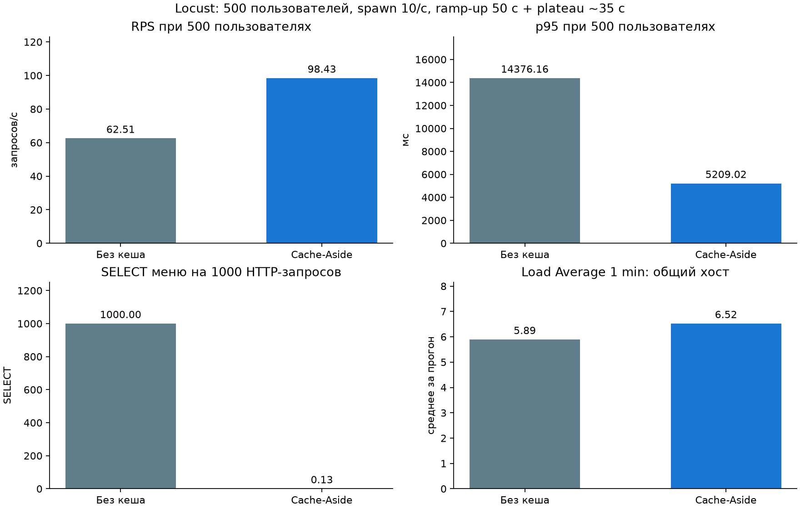

# Измерения Cache-Aside

Измерено 2 ноября 2026 г. Настройки и сырые значения: [summary.json](load/summary.json).

Один Uvicorn worker, настоящая JWT-аутентификация студента, 500 пользователей Locust, spawn rate 10/с, ожидание между запросами 0.1–0.5 с. Каждый прогон длится 85 с: ~50 с разгона и ~35 с при 500 пользователях. В тестовой базе 10000 синтетических блюд, 3 категории; API возвращает первые 100 с JOIN и сортировкой. В baseline выключен только кеш (`CACHE_ENABLED=false`); SQL, авторизация, данные и настройки сервера одинаковы. Прогоны последовательные, без искусственного sleep в запросе или отключения безопасности. Устойчивое окно — строго от 50-й до 85-й секунды, без завершающего drain; число ответов и итоговые метрики берутся из events.quitting Locust, а не последнего периодического CSV-снимка. Это одна пара прогонов на общем облачном хосте; выводы не являются SLA или универсальным коэффициентом ускорения.

## Всё окно (разгон + плато + завершение запросов)

| Метрика | До | После |
|---|---:|---:|
| HTTP-запросов | 5639 | 7784 |
| Ошибок | 0 | 0 |
| RPS | 62.85 | 85.26 |
| Средняя latency, мс | 5328.61 | 3819.96 |
| p95, мс (бакет Locust) | 14000.00 | 8200.00 |
| Load Average 1 min, среднее хоста | 5.89 | 6.52 |

## Плато после 50-й секунды

| Метрика | До | После |
|---|---:|---:|
| RPS | 62.51 | 98.43 |
| Средняя latency, мс | 8039.68 | 4444.36 |
| p95, мс (по отдельным ответам) | 14376.16 | 5209.02 |
| Запросов в окне | 2188 | 3445 |

## Работа PostgreSQL

| Метрика | До | После |
|---|---:|---:|
| SELECT меню | 5639 | 1 |
| Время исполнения SELECT меню, мс | 37362.16 | 29.37 |
| Строк от SELECT меню | 563900 | 100 |
| Все SELECT (auth, pre-ping, снимки) | 26700 | 21533 |
| SELECT меню на HTTP-запрос | 1.0000 | 0.0001 |
| Все SELECT на HTTP-запрос | 4.7349 | 2.7663 |

Счётчики — разность снимков pg_stat_statements в выделенной базе до и после Locust. Запросы меню выделены по `FROM menu`, учитывается реальное число исполнений в PostgreSQL. Прогрев происходит до первого снимка, поэтому его один SELECT не включён в окно кешированного прогона. Ошибок HTTP нет. Все SELECT не исчезают: каждый защищённый запрос продолжает проверять сессию и пользователя в БД, а пул делает pre-ping. Редкие SELECT меню после прогрева — fallback при коротком таймауте Redis на загруженном хосте; они включены в счётчик и не скрываются. Поэтому кеш снимает повторное чтение **меню**, а не всю нагрузку с PostgreSQL. Метрика Load Average снята через os.getloadavg с общего хоста, включает генератор нагрузки и другие процессы, не является CPU PostgreSQL; по ней нельзя приписать эффект только СУБД.

На плато RPS изменился в 1.57 раза; p95 — с 14376.16 до 5209.02 мс. Это фактический результат данной модели; обещание «ускорения в десятки раз» из примера задания не используется как измеренный факт. Узким местом могут оставаться аутентификация, сериализация, пул соединений, один worker и CPU хоста. Для production нужны повторные прогоны и распределённый генератор.

### Отдельная первая попытка: исчерпание пула

До исправления времени жизни соединений первый baseline получил 678 ответов, из них 66 HTTP 500; p95 Locust — 65000 мс. Соединения удерживались до финализации HTTP-ответа, что при 500 пользователях приводило к таймауту QueuePool (5 + 10). Артефакты сохранены [отдельно](load/initial-pool-exhaustion/baseline_stats.csv). Эти цифры не включены в график основной пары. Перед повторением **обоих** прогонов освобождены read-соединения аутентификации до возврата dependency и введён ограниченный контекст чтения меню, закрывающий соединение до сериализации. Добавлен регрессионный тест. Поэтому улучшение после этой починки не приписывается Redis.

[Baseline CSV](load/baseline_stats.csv) · [Cached CSV](load/cached_stats.csv) · [История baseline](load/baseline_stats_history.csv) · [История cached](load/cached_stats_history.csv). Сводки steady-window содержат число реально запущенных пользователей, финальные метрики и ошибки. Периодические CSV могут не включать последние ответы при завершении; итоговая таблица использует финальный JSON. Небольшой избыток SQL над завершёнными HTTP-запросами возможен из-за запросов, начатых при остановке пользователей. Bearer-токен, пароль и URL с паролем в артефакты не записываются.
