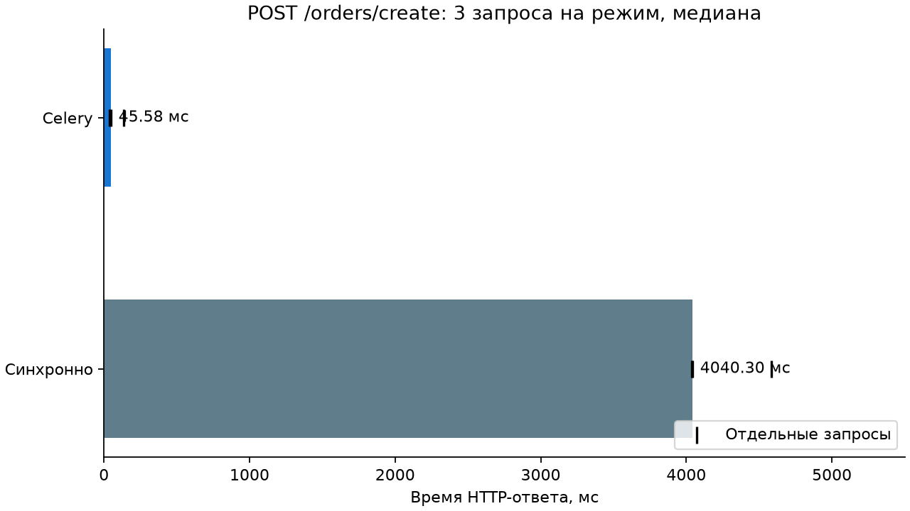
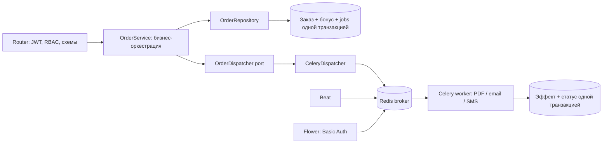
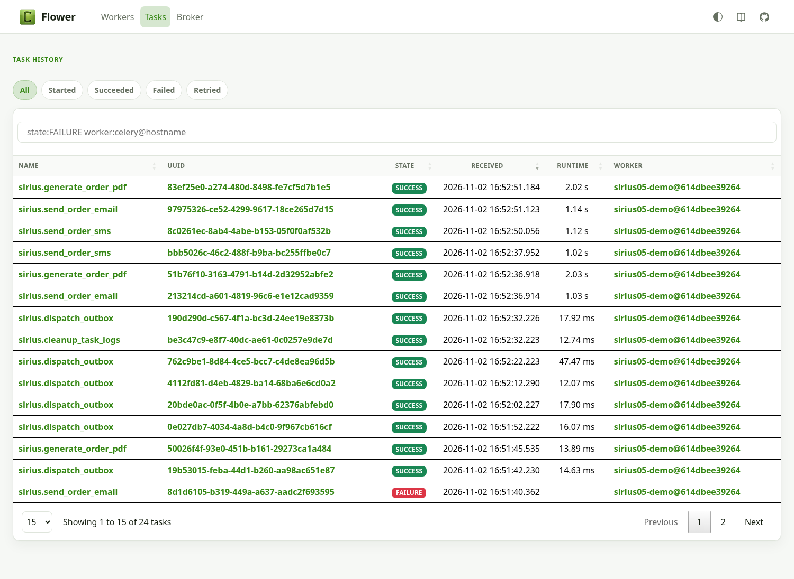
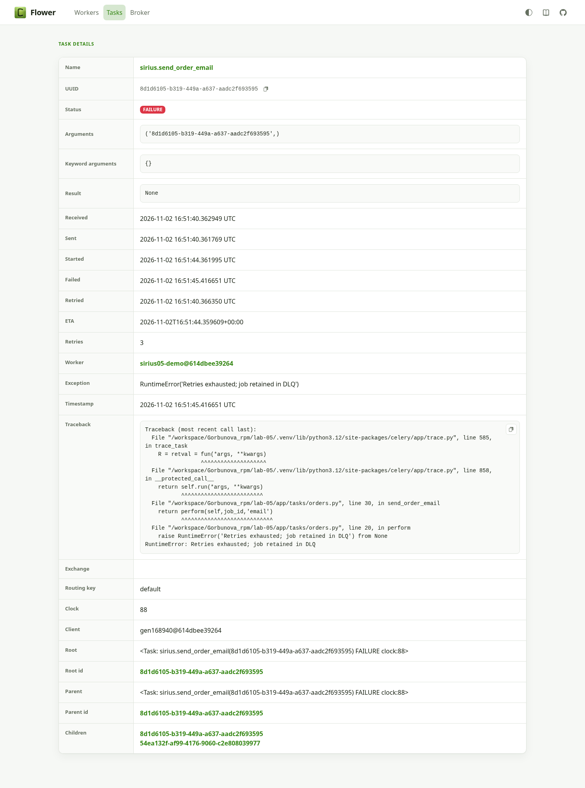

# Лабораторная №5. Celery: асинхронность и фоновые задачи

Самодостаточная версия «Сириус.Еда» на основе `lab-04/`. Сохранены JWT/RBAC/IDOR, refresh rotation, bcrypt, Redis rate limiting и Cache-Aside. Все тяжёлые операции после создания заказа выполняются отдельным Celery-воркером; реализованы exponential retries, фактическая DLQ, идемпотентность, Flower и периодическая задача Celery Beat. Другие лабораторные и их базы не изменяются.

PDF/email/SMS здесь **симулируются** с задержками 2/1/1 с и записью эффекта в PostgreSQL, как разрешено в задании. Реальных писем и SMS приложение не отправляет; файл PDF не формируется. Это позволяет безопасно воспроизвести очередь, задержки и сбои без внешних аккаунтов.

[Подробные измерения](docs/measurements.md) · [Протокол проверки](docs/validation.md) · [Результаты](docs/demo/results.json).

<!-- measurements:start -->
## Измеренное время ответа



| Режим | 3 HTTP-запроса, мс | Медиана, мс |
|---|---|---:|
| Синхронно | 4586.71, 4039.32, 4040.30 | 4040.30 |
| Celery | 134.42, 45.58, 36.13 | 45.58 |

В этом опыте ответ ускорился в **88.6 раза**. Измерены реальные HTTP-запросы с JWT, PostgreSQL и Redis; воркер работает отдельным prefork-процессом. Тяжёлые операции — явно заданные учебные симуляции 2 + 1 + 1 с, а не внешние SMTP/SMS-провайдеры. Celery сокращает ожидание ответа, не общую длительность работы. Три измерения показывают этот сценарий, не являются оценкой p95 или SLA. Порядок — sync, затем celery; включена первая постановка с подключением к брокеру.
<!-- measurements:end -->

## Запуск

Python 3.12, Docker с Compose v2. Из корня репозитория:

```bash
cd lab-05
python3 -m venv .venv
source .venv/bin/activate
pip install -r requirements-dev.txt
python scripts/init_env.py
docker compose up -d --wait db redis
alembic upgrade head
python -m app.bootstrap admin@example.org
```

`init_env.py` создаёт приватный игнорируемый `.env` со случайными паролем PostgreSQL, JWT-ключом и паролем Flower; повторный вызов его не перезаписывает. Для Swagger установите `DEBUG=true` в `.env`; по умолчанию production docs выключены. Создание admin требует безопасного ввода пароля в терминале. Публичная регистрация даёт только student; admin назначает cook/courier через PATCH /users/{id}.

Запустите четыре процесса **в отдельных терминалах**, каждый из `lab-05/` с активированной `.venv`:

```bash
python scripts/run.py api
python scripts/run.py worker
python scripts/run.py beat
python scripts/run.py flower
```

API: http://127.0.0.1:8000/docs при DEBUG=true. Flower: http://127.0.0.1:5555; браузер запросит Basic Auth из FLOWER_BASIC_AUTH в локальном `.env`. Пароль в аргументы процесса и скриншоты не попадает. Внешний доступ к API/Flower не открыт; для внешнего размещения необходим HTTPS и контроль доступа. Beat запускается **одним экземпляром**; worker слушает только очередь default, concurrency=2, prefork, events включены.

Инфраструктура отдельная: Compose project `rpm-lab05`, PostgreSQL на `127.0.0.1:15435`, Redis на `127.0.0.1:16382`, отдельные volumes pgdata и redisdata. Redis AOF включён, appendfsync everysec; это не обещание отсутствия потери последней секунды при аварии диска. Обычная остановка: Ctrl+C у процессов и `docker compose stop`.

Redis DB 0 — кеш и лимиты, DB 1 — Celery broker, DB 2 — result backend. Все Celery-ключи имеют префикс `sirius05:`. Настройки CELERY_BROKER_URL/CELERY_RESULT_BACKEND при необходимости переопределяют эти адреса. Не используйте FLUSHALL для очистки кеша: он удалит и очередь. Results живут 1 час; долговременное состояние находится в PostgreSQL.

## Ручная демонстрация в Swagger

1. Через POST /users/register зарегистрируйте student, а через **Authorize** войдите: email вводится в username (`POST /auth/token`). JSON-вход — POST /auth/login.
2. Cook/admin создаёт блюдо через POST /menu/items. Student не может менять меню. Матрица прав и кеш меню сохранены из [lab-03](../lab-03/README.md) и [lab-04](../lab-04/README.md).
3. Student вызывает POST /orders/create: `{"item_id":1,"quantity":2}`. Ответ сохраняет форму `{"status":"success","order_id":1}` и статус 201. Владелец определяется по JWT, не payload.
4. GET /orders/{id}/jobs показывает id, kind, status, attempts и безопасный код ошибки трёх операций. Доступ — владельцу или admin; чужому студенту — 403. Уведомление может завершиться позже ответа API; ошибка уведомления не отменяет сохранённый заказ.
5. В Flower видны generate_order_pdf, send_order_email и send_order_sms. Для проверки ретраев установите `DEMO_FAIL_EMAIL_MODULO=5` в `.env` и **перезапустите worker**. Создайте новый заказ с id, кратным 5: email выполнит 4 попытки (начальная + 3 ретрая) с отсрочками 1, 2 и 4 с, затем станет DEAD/FAILURE. Номера заказов не сбрасывайте в рабочей базе ради демонстрации.
6. При обычном `DEMO_FAIL_EMAIL_MODULO=0` постоянная ошибка отключена. `DEMO_TRANSIENT_EMAIL_FAILURES=2` позволяет проверить восстановление после двух неудач. Сменив настройки, перезапускайте соответствующий процесс.
7. Проверьте настоящую DLQ: `docker compose exec redis redis-cli -n 1 LLEN sirius05:dlq`. `LRANGE sirius05:dlq 0 -1` показывает сообщения Celery с job_id, безопасным error и attempts. Очередь dlq никто автоматически не исполняет.
8. Локальный оператор может просмотреть долговременные записи: `python -m app.operations dlq`. После устранения причины ошибки: `python -m app.operations redrive JOB_UUID`. Разрешён только DEAD job, выполняется только эта незавершённая операция; успешные PDF/SMS не дублируются. Запись DLQ сохраняется с redriven_at; старое транспортное сообщение остаётся свидетельством, а не автоматически повторяемой задачей.
9. При остановленном worker заказы продолжают сохраняться и ставиться в очередь; после запуска задачи выполняются. Результат фоновой задачи не возвращается произвольному пользователю через общедоступный AsyncResult endpoint.

## Архитектура и надёжность



Service определяет, что после создания заказа нужны PDF, email и SMS; вызывает абстрактный OrderDispatcher. Router не импортирует задачи/Celery и не вызывает delay. Service не импортирует FastAPI, SQLAlchemy, Redis или Celery — границы даже строже примера задания. Адаптер ставит три именованные задачи через send_task; это тот же реальный механизм публикации, что delay, с явными task_id и очередью. В Celery передаётся только UUID задания, без email, телефона, ORM-объекта или пароля.

### Сохранение заказа и доставка задания

OrderService передаёт список операций и быстрые бонусы (учебное правило: 1 балл за единицу блюда). Repository одной транзакцией сохраняет orders, order_bonuses и три order_jobs — это durable outbox. Публикация происходит **после COMMIT**. Поэтому worker не увидит отсутствующий ещё заказ, а отказ брокера не теряет задание. Сам Repository не знает о Celery.

CeleryDispatcher публикует pending jobs под SELECT FOR UPDATE SKIP LOCKED, отмечает published_at только после публикации, не ждёт результатов задач. Блокировка удерживается на время короткой публикации, чтобы worker не успел занять тот же job и заставить API ждать тяжёлую операцию. При недоступности брокера уведомление остаётся в БД, API сохраняет заказ. При полном отказе общего Redis лимитер из предыдущей работы по-прежнему может отклонить создание с 503 **до записи**; отдельный тест недоступного broker endpoint сохраняет работающие кеш/лимиты.

Beat каждые 10 с ставит задачу восстановления outbox. Jobs без published_at или с PENDING/RETRYING старше 60 с публикуются вновь; это покрывает потерю сообщения и аварийный разрыв между публикацией и фиксацией отметки. Пока сам Redis недоступен, Beat тоже не может доставить задачу; после восстановления очередной tick возобновит процесс. PostgreSQL должен оставаться доступным. Повторная публикация допускается и безопасна на уровне эффекта.

### Идемпотентность и сбои worker

Worker блокирует строку order_jobs до завершения операции. Для SUCCEEDED/DEAD повтор возвращает skipped; конкурентная копия ждёт и затем видит уже зафиксированное состояние. Имитация PDF/email/SMS записывает order_effects, а SUCCEEDED — в **одной PostgreSQL-транзакции**. Уникальны (order_id,kind), бонус привязан PK к order_id. Проверка не исчезает через час и не имеет гонки `EXISTS → работа → SET`.

`acks_late`, `task_reject_on_worker_lost` и visibility timeout 60 с дают повторную доставку при потере worker; prefetch=1, soft/hard limits 20/25 с. Демонстрация реально убивает дочерний процесс во время PDF, после чего задача выполняется снова и оставляет один эффект. Настройки дают **at-least-once**, не магическое exactly-once. Для настоящего SMTP/SMS нужен provider idempotency key или иной протокол: внешнюю отправку и PostgreSQL COMMIT нельзя сделать одной обычной транзакцией. Здесь доказано отсутствие дубля для локального симулируемого эффекта; у реального внешнего провайдера нужны отдельные гарантии. Идемпотентность задач не равна идемпотентности повторного POST создания заказа.

### Ретраи и DLQ

Временная симулируемая ошибка фиксирует RETRYING и attempt log, затем bound task вызывает retry с countdown 1/2/4 с, max_retries=3. Это **4 попытки**, а не 3, как можно ошибочно понять из текста задания. Для неустранимой ошибки после последней попытки фиксируются DEAD и dead_letters, а отдельное сообщение **действительно публикуется в dlq**. Одного объявления Queue('dlq') недостаточно — Celery сам не перемещает туда упавшие задачи.

Если в момент финальной ошибки DLQ Redis недоступна, запись PostgreSQL остаётся, publisher/Beat позже отправит её. Разрыв после отправки, но до фиксации published_at допускает дубль транспортного сообщения DLQ; анализируется устойчивый job_id. В payload и task_logs нет адресов/секретов. Учебная демонстрация использует детерминированные отсрочки без jitter, чтобы показать 1/2/4; для массовых production-сбоев полезен jitter и ограничение потока повторов.

### Celery Beat

Раз в 60 с cleanup_task_logs удаляет только логи старше 30 дней и добавляет maintenance_runs. Состояние идемпотентности, эффекты, бонусы и DLQ не удаляются. Beat — планировщик, сам работу не исполняет; задачу выполняет worker из default. BEAT_CLEANUP_SECONDS и BEAT_OUTBOX_SECONDS меняют интервалы, в CI они сокращены до 1 с. Это тестовое ускорение не скрывает реальные интервалы локальной демонстрации.

## Flower: реальные скриншоты





Скриншоты сделаны Chromium с работающего Flower, не нарисованы. Учётные данные переданы через browser HTTP credentials, в URL их нет. Полная демонстрация проверяет также аутентифицированный Flower API.

## Тесты и воспроизведение

```bash
# Один раз:
docker compose exec db createdb -U sirius sirius_test
python scripts/check.py
```

Проверки используют PostgreSQL и Redis, не SQLite/in-memory брокер. Сохранены 40 тестов lab-04, добавлены тесты атомарности outbox/bonus, конкурентной идемпотентности, отката эффекта при сбое COMMIT, retry exhaustion, transient recovery, публикации DLQ, восстановления outbox и retention. Redis для pytest: DB 15 кеш/лимиты, 13 брокер, 14 результаты. Тесты отказываются работать без БД `_test`; очищаются только тестовые таблицы и ключи отдельных DB.

Полная демонстрация с настоящими процессами и измерениями:

```bash
pip install -r requirements-demo.txt
python scripts/integration.py
python scripts/report.py
```

Для скриншотов нужен установленный Chromium по `/usr/bin/chromium`. Генерация графика использует Matplotlib; это визуализация измеренных данных. Скрипт создаёт/очищает только отдельную БД с суффиксом `_integration`, использует Redis DB 10/11/12, запускает API на 18005 и Flower на 15555. Скрипт требует право создавать тестовую базу (локальная Compose-роль его имеет). Основные данные приложения и прежние лабораторные не затрагиваются. Процессы и файлы runtime останавливаются/очищаются в finally; действующие пароли, Basic Auth и Bearer в отчёт не записываются.

Выполняются: три sync и три Celery HTTP-запроса; настоящий worker и retry; DLQ в Redis; повторный запуск PDF; Beat tick с интервалом 60 с; отказ endpoint брокера с сохранением заказа и восстановлением outbox; создание при выключенном worker и выполнение после перезапуска; принудительное убийство дочернего процесса во время PDF; Flower API и скриншоты. Восемь заказов дают 24 job, из них один email DEAD по сценарию и 23 успешных эффекта. Это ожидаемая проверка отказа, а не необработанная ошибка проекта.

[GitHub Actions](../.github/workflows/lab-05.yml) запускает pytest и `scripts/integration.py --quick` с настоящими Redis/worker/Beat/Flower. Quick пишет временные артефакты в игнорируемый docs/ci/, не перезаписывая полный отчёт. Он сокращает задержки, не включает eager и не делает браузерные снимки/убийство child-процесса; полный локальный прогон содержит эти дополнительные доказательства. [JUnit](docs/test-results.xml), [полный результат](docs/demo/results.json), логи и [проверки](docs/validation.md) сохранены в репозитории.

## Ответы для защиты

1. Service знает правило «после заказа сформировать чек и уведомить». Router занимается транспортом и доступом. Dispatcher port позволяет поменять очередь и тестировать бизнес-логику без FastAPI/Celery.
2. С late ACK и reject_on_worker_lost задача может быть доставлена снова. При гибели child родитель делает requeue; при потере всего worker применяется visibility timeout. Поэтому необходима идемпотентность и долговременное состояние, а не только result backend.
3. Повторное исполнение должно оставлять тот же бизнес-результат. Здесь уникальный job/effect, row lock и общий COMMIT защищают даже конкурентные повторы. У внешнего сервиса потребуется его ключ идемпотентности.
4. Backoff уменьшает давление на временно недоступный сервис и даёт ему восстановиться. Нужны предел попыток и обычно jitter, иначе множество задач повторятся одновременно.
5. DLQ хранит исчерпавшие попытки задачи для расследования и контролируемого redrive после устранения причины. Она не создаётся автоматически от одного объявления очереди. Здесь есть и сообщение Redis, и долговременная запись PostgreSQL.
6. Celery даёт брокер, распределённые worker, ACK/redelivery, retries, маршрутизацию, результаты и мониторинг. Threading/asyncio решают конкурентность процесса, но сами не сохраняют задания и не организуют эти гарантии между машинами. Celery не заменяет async/await для неблокирующего I/O в API.
7. Обычную задачу ставит событие/клиент; Beat ставит её по расписанию. Beat не выполняет тело задачи и должен иметь единственный активный планировщик для такого расписания.
