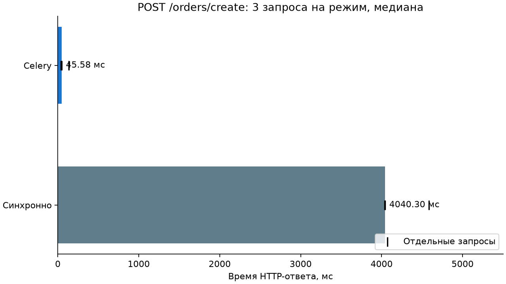
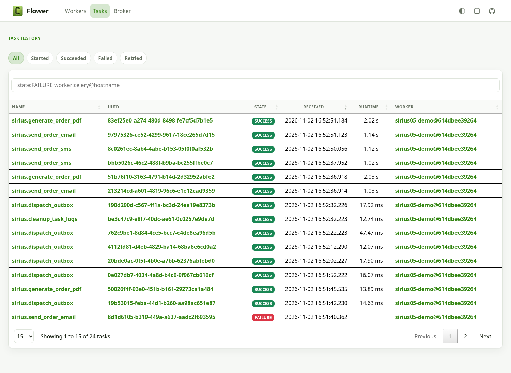
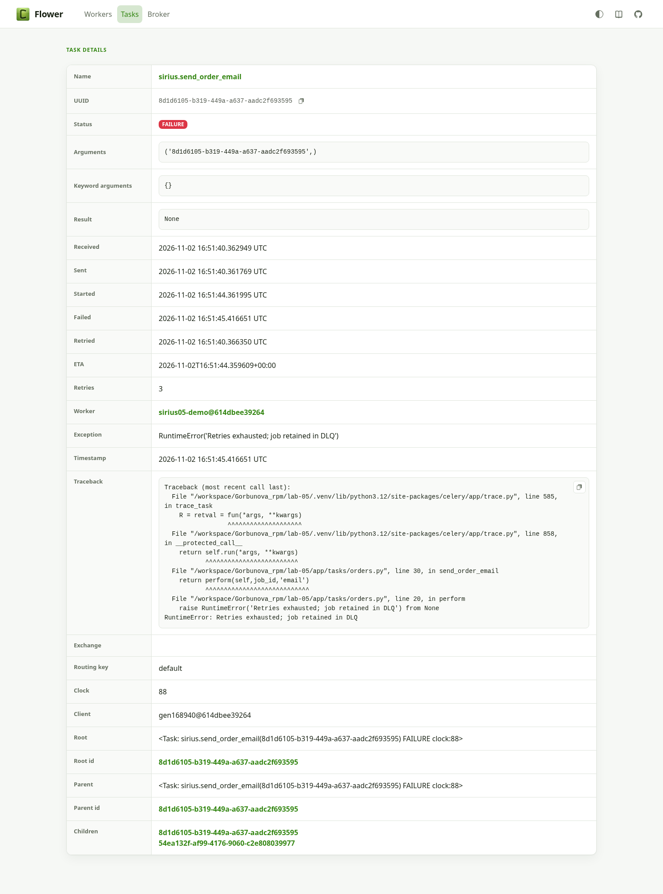

## Измеренное время ответа

| Режим | 3 HTTP-запроса, мс | Медиана, мс |
|---|---|---:|
| Синхронно | 4586.71, 4039.32, 4040.30 | 4040.30 |
| Celery | 134.42, 45.58, 36.13 | 45.58 |

В этом опыте ответ ускорился в **88.6 раза**. Измерены реальные HTTP-запросы с JWT, PostgreSQL и Redis; воркер работает отдельным prefork-процессом. Тяжёлые операции — явно заданные учебные симуляции 2 + 1 + 1 с, а не внешние SMTP/SMS-провайдеры. Celery сокращает ожидание ответа, не общую длительность работы. Три измерения показывают этот сценарий, не являются оценкой p95 или SLA. Порядок — sync, затем celery; включена первая постановка с подключением к брокеру.

## Проверенные сценарии

- `real_retries_attempts`: `4`.
- `real_dlq_message`: `True`.
- `duplicate_skipped`: `True`.
- `flower_authenticated_api`: `True`.
- `real_beat_cleanup`: `True`.
- `broker_outage_order_preserved_and_recovered`: `True`.
- `worker_child_killed_during_pdf`: `True`.
- `worker_restart_and_effects_once`: `True`.

Четыре попытки email заказа №5 фиксируются в task_logs. Первые три RETRYING, последняя DEAD; последняя Celery-задача FAILURE, в Redis лежит отдельное сообщение dlq. Обычный worker слушает только default. Остальные уведомления и сам заказ сохранены.

[Машиночитаемый результат](demo/results.json) · [Worker](demo/worker.log) · [Worker после перезапуска](demo/worker-restarted.log) · [Beat](demo/beat.log).

## Flower: реальные снимки

