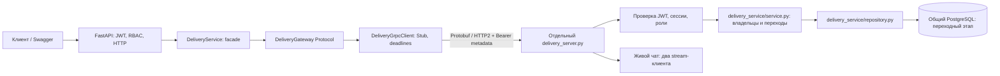

# Практическая №6. Delivery как gRPC-микросервис

Отдельная самодостаточная версия «Сириус.Еда» на основе `lab-05/`. Применён Strangler Fig: только delivery перенесён в отдельный процесс; users/menu/orders, безопасность, Cache-Aside и Celery остаются в монолите. Старые работы и их базы не меняются.

Реализованы unary RPC, Server Streaming трекинга **реальных** статусов и Bidirectional Streaming чата **двух клиентов**, обработка UNAVAILABLE/DEADLINE_EXCEEDED, сохранение RBAC/IDOR и повторная проверка JWT внутри gRPC-сервиса. [Контракт](proto/delivery.proto), [проверки](docs/validation.md), [результат двухпроцессной демонстрации](docs/live/results.json).

## Запуск

Python 3.12, Docker Engine с Compose v2. Из корня репозитория:

```bash
cd lab-06
python3 -m venv .venv
source .venv/bin/activate
pip install -r requirements-dev.txt
python scripts/init_env.py
docker compose up -d --wait db redis
alembic upgrade head
python scripts/generate_proto.py
python -m app.bootstrap admin@example.org
```

Генератор выполняет `python -m grpc_tools.protoc -Iproto --python_out=. --grpc_python_out=. proto/delivery.proto` с абсолютными путями. Сгенерированные delivery_pb2.py и delivery_pb2_grpc.py включены в Git, не написаны вручную. Версии grpcio/grpcio-tools/protobuf закреплены; CI проверяет, что повторная генерация не меняет код.

В двух терминалах, каждый из `lab-06/` с активной `.venv`:

```bash
# Терминал 1:
python delivery_server.py
# Терминал 2:
python scripts/run.py api
```

gRPC слушает `127.0.0.1:50051`, HTTP — `127.0.0.1:8000`. Для Swagger установите DEBUG=true в `.env` и перезапустите API: http://127.0.0.1:8000/docs. По умолчанию документация выключена. Настройки и случайные секреты создаёт init_env.py в приватном игнорируемом `.env`; повторный вызов существующий файл не меняет. Администратор создаётся явно с вводом пароля в терминале.

Инфраструктура отдельная: Compose `rpm-lab06`, PostgreSQL `127.0.0.1:15436`, Redis `127.0.0.1:16383`, свои volumes. Основной Redis DB 0, Celery broker DB 1, result backend DB 2, префикс `sirius06:`. Для полного выполнения фоновых уведомлений можно дополнительно запустить в отдельных терминалах:

```bash
python scripts/run.py worker
python scripts/run.py beat
python scripts/run.py flower
```

Эти процессы сохранены из lab-05; для работы самой доставки они не обязательны. При отсутствии worker уведомления заказов ожидают в очереди. PDF/email/SMS остаются учебными симуляциями, внешние сообщения не отправляются. Базовые настройки безопасности, кеша и фоновых задач описаны в [lab-03](../lab-03/README.md), [lab-04](../lab-04/README.md), [lab-05](../lab-05/README.md). Остановка — Ctrl+C у Python-процессов и `docker compose stop`.

## Архитектура и границы



В монолите модуль delivery **не содержит SQL-репозитория**: он перемещён в delivery_service/. HTTP-роуты не импортируют сгенерированные классы или grpc; они вызывают facade через domain port. Facade не импортирует FastAPI, SQLAlchemy или grpc. Клиент — инфраструктурный адаптер: преобразует Protobuf в те же доменные Delivery DTO и RPC-ошибки в доменные исключения. Только API переводит их в HTTP.

Весь delivery business service и ORM-доступ находятся за сетевой границей. Тест отслеживает SQL на engine монолита и подтверждает отсутствие запросов к deliveries при назначении, чтении и списке через HTTP. Сервер использует другой engine/пул; двухпроцессная демонстрация дополнительно подтверждает это разными PID. Остальные модули по-прежнему локальные — это постепенный Strangler Fig, не переписывание всего приложения. Автоматического отката к прямой работе с БД при ошибке сети нет.

**Это переходный микросервис с общей БД**, как разрешено заданием. Он использует shared models, JWT-настройки, auth-репозиторий, users и orders для проверок. Модель и миграции deliveries ещё находятся в общей metadata. Поэтому сервис не объявляется полностью автономным по данным/развёртыванию. Следующий этап: собственная БД, авторитетные API/события users/orders, отдельные миграции, backfill и согласованный cutover; пока не делаем вид, что общей зависимости нет.

Транспорт insecure используется только для локальной демонстрации. Сервер отказывается слушать non-loopback bind без реализованного TLS. При внешнем размещении потребуются TLS/mTLS и соответствующая модель сервисной аутентификации; в этой работе такой deployment не выполнен.

## Контракт и HTTP API

Пакет `delivery.v1`, идентификаторы int64. Общий ответ Delivery содержит id, order_id, customer_id, courier_id, status. Это расширение минимального примера задания сохраняет полноценный REST-ответ предыдущей работы. GetDelivery использует oneof: можно искать по delivery_id или order_id, но не одновременно. Роли и actor_id в запросах отсутствуют.

| HTTP | RPC | Доступ |
|---|---|---|
| POST /delivery/assign | AssignCourier | admin, активный courier, существующий PENDING order |
| POST /delivery (совместимый alias) | AssignCourier | тот же |
| GET /delivery/{id} | GetDelivery по delivery_id | владелец заказа, назначенный courier, admin |
| GET /delivery/order/{id} | GetDelivery по order_id | те же |
| GET /delivery | ListDeliveries | фильтр по владельцу/курьеру, admin все (до 100) |
| POST /delivery/{id}/start | AdvanceDelivery | только назначенный courier |
| POST /delivery/{id}/complete | CompleteDelivery | только назначенный courier |
| GET /delivery/{id}/track | TrackDelivery → SSE | те же права чтения |

CompleteDelivery принимает ASSIGNED или ON_THE_WAY, чтобы сохранить совместимость lab-05. Повторное завершение — 409. Назначить второй delivery для того же заказа нельзя: уникальный order_id, конфликт 409. Новая миграция добавляет ON_THE_WAY в CHECK constraint. Downgrade переводит незавершённые ON_THE_WAY обратно в ASSIGNED, затем возвращает старый CHECK; другие записи сохраняются.

### Безопасность на сетевой границе

Монолит проверяет access JWT и роли, затем передаёт исходный Bearer в metadata `authorization`. Сервис повторно проверяет подпись/exp/iss/aud/type, текущую сессию и пользователя в БД. Роли не читаются из произвольного тела RPC. Поэтому вызов gRPC напрямую с чужим токеном тоже даёт PERMISSION_DENIED, а без токена — UNAUTHENTICATED. Профиль, блокировка, logout и отзыв сессии продолжают действовать; streaming перепроверяет права перед отправкой данных.

Чужой студент/курьер не читает доставку и не попадает в её чат. Sender ID чата назначает сервер; клиенту запрещено заполнять output-поля. Токены не передаются через URL, аргументы командной строки, логи или результаты демонстрации.

### Ошибки и таймауты

| gRPC status | HTTP |
|---|---:|
| NOT_FOUND | 404 |
| UNAUTHENTICATED | 401 |
| PERMISSION_DENIED | 403 |
| FAILED_PRECONDITION / ALREADY_EXISTS | 409 |
| INVALID_ARGUMENT | 422 |
| UNAVAILABLE / RESOURCE_EXHAUSTED | 503 |
| DEADLINE_EXCEEDED | 504 |

Unary deadline по умолчанию 5 с. В HTTP возвращаются безопасные сообщения, не серверный traceback. Канал переиспользуется в lifespan и закрывается при остановке. Отказ delivery не выключает menu/users/health; после восстановления сервис доступен по тому же каналу. Нет скрытых автоматических retry изменяющих вызовов: deadline не доказывает, что запись не выполнилась. После неопределённого результата AssignCourier можно проверить доставку по order_id. Повторное назначение защищено уникальностью; это не универсальная exactly-once RPC-гарантия.

Настройки `.env`:

```dotenv
DELIVERY_GRPC_TARGET=127.0.0.1:50051
DELIVERY_GRPC_BIND=127.0.0.1:50051
DELIVERY_TIMEOUT_SECONDS=5
DELIVERY_POLL_SECONDS=2
DELIVERY_STREAM_SECONDS=30
```

## Streaming: трекинг и настоящий двусторонний чат

### Server Streaming

TrackDelivery сообщает только изменения настоящего состояния: `ASSIGNED → ON_THE_WAY → DELIVERED`. ASSIGNED соответствует начальному in_progress из шаблона задания; значения REST сохранены из прошлого проекта. Poll interval 2 с. Начальное значение отправляется сразу, последующие читает сервис после реальных команд courier; чтение потока **само не меняет статус**. На время ожидания не удерживается DB-соединение. На DELIVERED поток заканчивается, по deadline/отмене освобождается.

1. Войдите admin в Swagger, создайте/найдите заказ студента и назначьте courier через POST /delivery/assign.
2. Из терминала студента:

```bash
python scripts/delivery_client.py track 1 --email student@example.org
```

Пароль вводится через getpass, токен получается через login. В другом терминале/Swagger назначенный courier вызывает `/delivery/1/start`, затем `/delivery/1/complete`. В консоли последовательно появятся три статуса. При отсутствии переходов нечего «проигрывать»: поток ожидает реальные изменения и ограничен временем. Есть и SSE-адаптер HTTP с теми же правами; preflight даёт обычный 401/403/503 до открытия потока, ошибка после открытия отправляется событием error.

### Bidirectional Streaming

В двух терминалах войдите разными участниками **одной** доставки:

```bash
python scripts/delivery_client.py chat 1 --email student@example.org
python scripts/delivery_client.py chat 1 --email courier@example.org
```

После `[joined]` вводите сообщения, `/quit` завершает клиент. Каждый stream одновременно принимает и отправляет; второй клиент получает сообщения первого и может ответить. Сервер не выдаёт автоматический «ответ курьера» и не подменяет человека echo-ботом. Отправитель также получает собственное событие, поэтому обе стороны видят один порядок sequence. Учебный live hub расположен в памяти **одного** процесса, без истории и гарантии доставки при разрыве; после перезапуска подписки/история пропадают, но доставки в PostgreSQL сохраняются. Для нескольких replicas нужен общий pub/sub/журнал и протокол возобновления.

Первая пустая ChatMessage — join с delivery_id; сервер отвечает event=joined. Сообщения до 1000 символов, до 100 сообщений на stream, до 16 участников комнаты; буфер читателя ограничен 100 событиями, медленный читатель отключается. Максимум 32 одновременных RPC; streaming нельзя считать бесплатным. Длительность ограничена 30 с настройкой и client deadline. Sender/sequence/time/event — output-only. Права проверяются при входе, публикации и перед выдачей сообщения. Это демонстрационный чат, не production-мессенджер с хранением переписки.

## Проверки и демонстрация

```bash
# Один раз:
docker compose exec db createdb -U sirius sirius_test
python scripts/check.py
python scripts/integration.py
```

`check.py` применяет миграции дважды, выполняет alembic check и pytest. Сохранены тесты безопасности, кеша и Celery lab-05; добавлены gRPC-контракт и контроль сетевой границы. Тестовый сервер действительно слушает TCP на случайном loopback-порту, а не замоканный stub. Unit-набор использует PostgreSQL `_test` и отдельные Redis DB 13/14/15. Тесты очищают только выделенные таблицы/ключи; не направляйте настройки на рабочие базы.

Двухпроцессная демонстрация создаёт отдельную БД `_integration` (нужно право CREATE DATABASE, локальная Compose-роль его имеет), очищает только её и выделенные Redis DB 10/11/12. Запускает Uvicorn на 18006 и отдельный delivery_server.py на 19051, получает настоящие JWT, назначает courier через HTTP→gRPC, проверяет прямой RPC с чужим/невалидным JWT, три реальных статуса, двух сетевых чат-клиентов, настоящий deadline, остановку backend→HTTP 503, доступность menu, перезапуск backend и сохранность доставки. Созданные фоновые уведомления остаются в выделенной очереди, Celery-worker в этой демонстрации не запускается.

Результат — [docs/live/results.json](docs/live/results.json), [лог сервиса](docs/live/delivery.log), [лог HTTP](docs/live/monolith.log). После проверки процессы завершаются. В CI `--quick` сокращает только poll interval, не заменяет сеть/процессы fake-сервисами.

[GitHub Actions](../.github/workflows/lab-06.yml) проверяет регенерацию Protobuf, pytest и реальную двухпроцессную интеграцию. [JUnit](docs/test-results.xml), [протокол](docs/validation.md). Ограничения общей БД, локального plaintext и непостоянного чата описаны явно.

## Ответы для защиты

1. Вынос delivery создаёт отдельную границу ответственности и позволяет независимо масштабировать/перезапускать обработку доставки. Цена — сеть, эксплуатация, распределённые ошибки и необходимость продуманной границы данных. В учебной версии зависимость от общего хранилища ещё остаётся.
2. gRPC даёт типизированный Protobuf-контракт, кодогенерацию, бинарные сообщения, HTTP/2, deadlines и streaming. Это удобно для управляемых внутренних клиентов. REST остаётся удобным для браузера/Swagger и открытого API; gRPC не гарантирует автоматического выигрыша по скорости на любой нагрузке.
3. UNAVAILABLE переводится в понятный 503, deadline — в 504; не ждём бесконечно и не раскрываем traceback. Другие модули остаются доступны. Повтор изменяющего запроса требует понимания идемпотентности, поскольку ответ мог потеряться уже после записи.
4. Своя БД даёт автономность схемы, владения данными и релизов. Общая создаёт coupling миграций, прав, блокировок, доступности и моделей. Здесь это осознанный переходный шаг; отдельная БД потребует также убрать прямые чтения users/orders через контракты/события.
5. Unary — один запрос/ответ, например AssignCourier. Server Streaming — один запрос и поток DeliveryStatus. Bidirectional — независимые потоки запросов/ответов, например одновременно пишущие участники чата.
6. Strangler Fig постепенно перенаправляет одну возможность на новый сервис, сохраняя остальные. В lab-06 HTTP facade delivery переходит на gRPC, другие модули остаются как были, предыдущая версия сохранена в lab-05.
7. DeliveryGrpcClient — адаптер инфраструктуры к DeliveryGateway port: скрывает Stub/Protobuf, metadata, дедлайны и транспортные ошибки. Бизнес-сервис работает с доменными сущностями/интерфейсом и не импортирует grpc.
