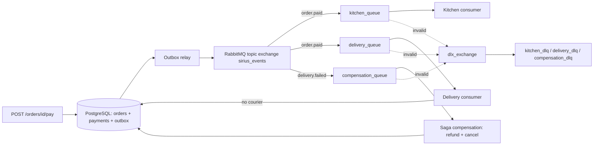

# Практическая № 7 — Event-driven архитектура

**Выполнила: Горбунова Дарья** · «Сириус.Еда» · продолжение lab-06.

Здесь сохранены FastAPI, PostgreSQL, Redis, Celery и gRPC из шестой работы. Добавлены RabbitMQ, `OrderPaid`, независимые consumers кухни и доставки, идемпотентность, DLQ, Saga-компенсация и Transactional Outbox. Оплата и возврат денег моделируются **только локальными записями в БД** (реальных транзакций нет).

## Архитектура



**Гарантии.** При вызове оплаты `orders.status=PAID`, `payments.status=CAPTURED` и запись в `event_outbox` фиксируются одной транзакцией. Relay отправляет сообщение с publisher confirms, затем ставит `published_at`. При падении RabbitMQ событие остаётся в БД и отправляется после восстановления. Подтверждение может потеряться, поэтому дубли всё ещё возможны. Consumers хранят `(consumer,event_id)` в `processed_events` в одной транзакции с результатом, а `order_id` уникален в таблицах кухни/доставки. Ack происходит после коммита. Poison messages отправляются в DLQ. Временные сбои БД приводят к requeue; ограничение повторов с backoff не реализовано.

**Saga.** Если `DEMO_NO_COURIER=true`, delivery worker вместо обычного запроса доставки создаёт `DeliveryFailed` через outbox. Compensation worker переводит платёж в `REFUNDED` (учебная имитация), заказ в `CANCELLED`, обнуляет бонусы и пишет `OrderCancelled` в outbox. Повторная компенсация не выполняет возврат дважды. В обычном режиме delivery_request остаётся PENDING, а назначение курьера по-прежнему производится через gRPC-интерфейс из lab-06. Это не полная автоматическая интеграция с поиском курьера, а сценарий отказа для демонстрации Saga.

## Как запустить на MacBook / Linux

Из каталога `lab07` (Python 3.11+, Docker):

```bash
python3 -m venv .venv
source .venv/bin/activate
pip install -r requirements-dev.txt
python scripts/init_env.py
docker compose up -d db redis rabbitmq
alembic upgrade head
python -m app.workers.dlq_setup
```

`scripts/init_env.py` генерирует случайные секреты и локальный `.env`; его нельзя коммитить. Порты lab07 изолированы от прошлых практик: PostgreSQL 15437, Redis 16384, RabbitMQ AMQP 5677, Management UI 15677. Веб-панель RabbitMQ: http://127.0.0.1:15677; логин и пароль из `.env`. Для Swagger поставьте `DEBUG=true` и запустите API.

В шести отдельных терминалах из `lab07` запустите:

```bash
python delivery_server.py
python scripts/run.py api
python -m app.workers.kitchen_consumer
python delivery_worker.py
python -m app.workers.compensation_consumer
python -m app.workers.outbox_worker
```

Swagger: http://127.0.0.1:8000/docs. Создайте пользователя/заказ (`POST /orders/create`), затем оплатите через `POST /orders/{id}/pay`. У кухни и доставки две независимые очереди, каждая получит `OrderPaid`. Повторная оплата возвращает `already_paid=true`, новая запись не создаётся.

Для сценария Saga установите `DEMO_NO_COURIER=true` в локальном `.env`, перезапустите delivery worker, создайте и оплатите **новый** заказ. Смотрите статусы `orders`, `payments`, `delivery_requests` и события `event_outbox`.

Для DLQ в RabbitMQ Management UI опубликуйте `not-json` с routing key `order.paid` в exchange `sirius_events`. Две копии будут отправлены в `kitchen_dlq` и `delivery_dlq`. Для идемпотентности повторно опубликуйте то же валидное событие с тем же `event_id` — таблицы не получат дублей.

## Проверки

```bash
python -m compileall -q app delivery_worker.py
pytest -q eda_tests/test_events.py
# интеграционный тест: отдельная БД с именем, заканчивающимся на _eda_test
EDA_TEST_DATABASE_URL=postgresql+psycopg2://.../sirius_eda_test pytest -q eda_tests/test_eda_integration.py
```

Проверка соединения с RabbitMQ и демонстрация end-to-end требуют запущенной локальной инфраструктуры; сам коммит этого не доказывает.

## Ответы на контрольные вопросы

1. **Зачем события вместо прямого gRPC?** Оплата и подписчики не связаны синхронным вызовом, кухня/доставка могут работать независимо.
2. **Exchange и Queue?** Exchange маршрутизирует сообщения по ключам; Queue хранит их до обработки.
3. **Идемпотентность?** Таблица `processed_events` с ключом `(consumer,event_id)` и уникальные заказы.
4. **Почему at-least-once?** Если ack потерялся, брокер доставит сообщение снова; exactly-once эффект возможен лишь благодаря согласованной обработке в БД.
5. **DLQ?** Отдельная очередь для невалидных сообщений и диагностики ошибок.
6. **Падение consumer до ack?** RabbitMQ выдаст неподтверждённое сообщение заново, БД не допускает дублей.
7. **Событие и команда?** `OrderPaid` описывает произошедший факт, `AssignCourier` просит выполнить действие.
8. **Зачем Saga?** Компенсирующие локальные транзакции (возврат и отмена) при ошибке другой части распределённого процесса.

## Ограничения

Сохранена общая учебная БД из lab-06; внешнего платёжного шлюза нет, `REFUNDED` — эмуляция. Outbox обеспечивает durable at-least-once доставку при восстановлении инфраструктуры, не exactly-once. Для эксплуатации необходимы ограниченные retries, мониторинг DLQ, отдельные сервисные credentials и устойчивый механизм назначения курьера.
